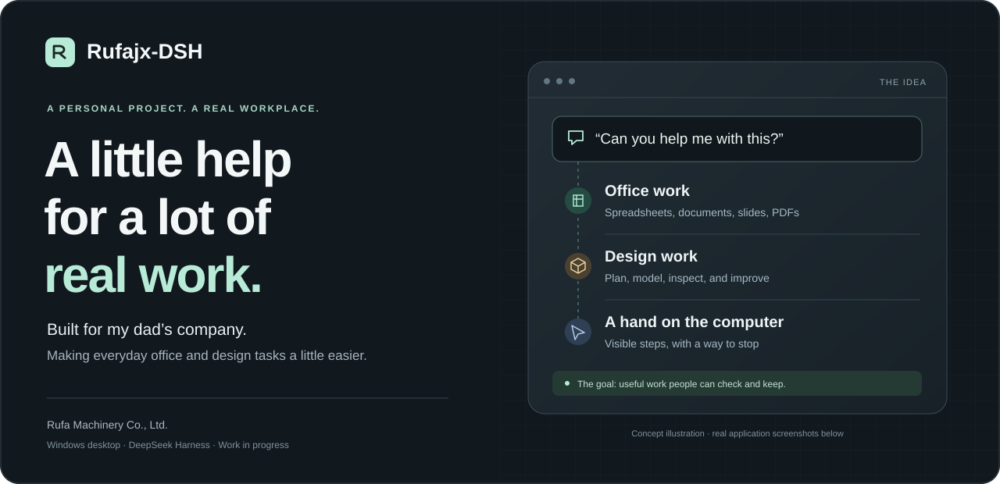
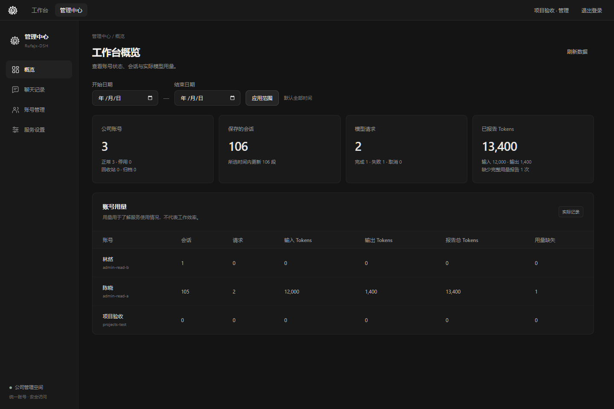
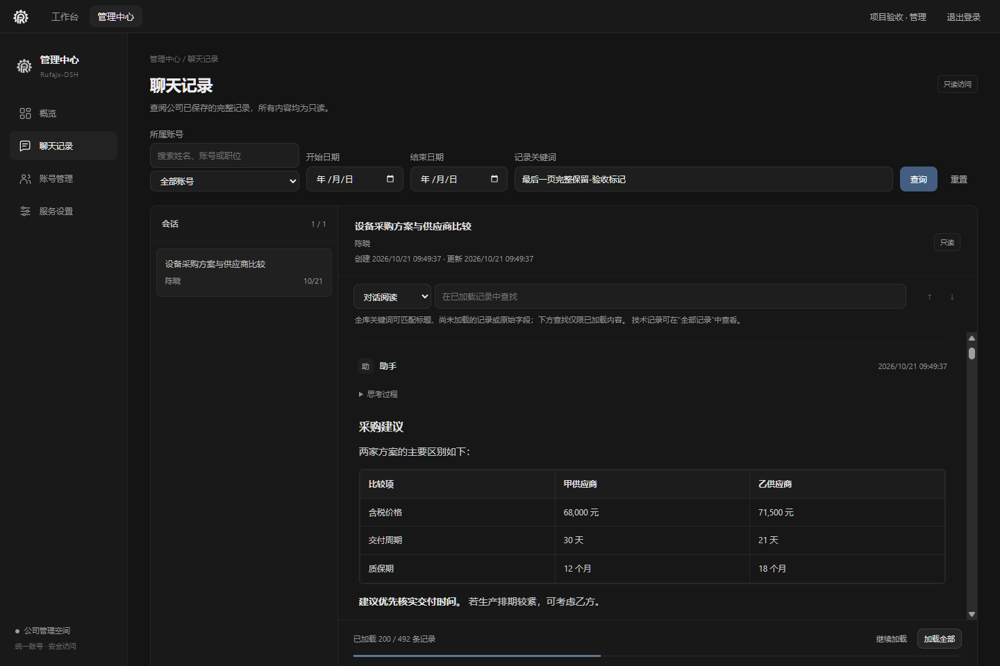
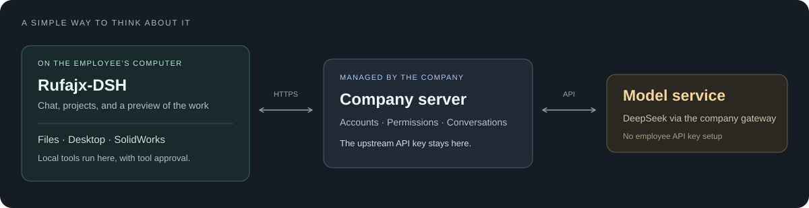

<p align="center">
  <a href="README.md">English</a> · <strong>简体中文</strong>
</p>

<p align="center">
  
</p>

<p align="center">
  <strong>一个做给爸爸的公司——如发机械有限公司——使用的 AI 工作台。</strong><br>
  希望让日常办公和设计中那些有点费时间的事情，变得轻松一点。
</p>

<p align="center">
  <a href="#为什么做这个项目">项目的由来</a> ·
  <a href="#它能帮什么忙">功能介绍</a> ·
  <a href="#看看实际界面">界面截图</a> ·
  <a href="#从源码开始">开始使用</a> ·
  <a href="#感谢这些项目">致谢</a>
</p>

<p align="center">
  <a href="https://github.com/Ha22yX/Rufajx-DSH/actions/workflows/source-checks.yml"></a>
  <br><sub>Windows x64 · 基于 DeepSeek Harness · 持续完善中</sub>
</p>

## 为什么做这个项目

我做 **Rufajx-DSH，是想帮助爸爸的如发机械有限公司提高办公效率和设计效率**。

想法其实很简单：同事需要整理表格、准备汇报、从文件里找资料，或者用 SolidWorks 做模型时，能不能直接用平常说话的方式说明需求？不用为了这些事情先学写代码，也不用自己研究一大堆 AI 工具怎么配置。

所以我想把这些能力放进一个 Windows 程序里，让它能用上工作中的文件、软件和公司账号。对我来说，这是一个一边学习、一边认真做的学生项目，但目标很实际：真的能帮上爸爸和同事们的忙。现在还有不少地方需要继续打磨。

**我希望它减少重复工作，让大家多留一点时间做需要自己判断的事情。**

## 它能帮什么忙

<table>
<tr>
<td width="50%" valign="top">
<h3>01 · 日常办公</h3>
<p>处理表格、文档、演示文稿、PDF 和扫描文字。把对话和文件放在一起，尽量少在不同工具之间来回复制内容。</p>
</td>
<td width="50%" valign="top">
<h3>02 · 一步一步辅助建模</h3>
<p>连接 SolidWorks 2016，先规划，再分步骤建模并检查结果。同一个会话尽量持续使用一个独立、可见的 SW 实例，让建模过程看得见、跟得上。</p>
</td>
</tr>
<tr>
<td valign="top">
<h3>03 · 帮忙操作电脑</h3>
<p>把电脑操作交给专门的子智能体。即使主程序在后台，桌面上的小浮层也会显示当前步骤；按 Esc 可以停止。</p>
</td>
<td valign="top">
<h3>04 · 文件改错了，还能找回来</h3>
<p>在支持的文件修改操作前保存旧版本，查看改动并恢复。历史版本以分支树展示，使用普通人能看懂的名称，不要求员工懂 Git。</p>
</td>
</tr>
<tr>
<td valign="top">
<h3>05 · 项目、媒体和个人习惯</h3>
<p>管理项目与参考文件夹，保存用户明确要求记住的工作偏好，预览音视频，也能按需调用内置 Remotion 技能制作视频。</p>
</td>
<td valign="top">
<h3>06 · 公司共用的一套工作台</h3>
<p>员工用公司账号登录。管理员可以管理账号、搜索会话、阅读完整记录和查看已记录用量。模型 API 密钥保留在服务器上。</p>
</td>
</tr>
</table>

这些是目前代码里包含的能力，不代表每种文件、视频格式或 CAD 操作都能完美完成。重要文档和工程设计结果仍然需要人来检查。

## 看看实际界面

下面是**真实管理界面在独立测试环境中的截图**。姓名、会话内容和用量数字都是模拟数据，不是真实员工记录或生产数据。目前程序界面主要使用中文。

### 先了解整体情况

账号、保存的会话和已记录用量放在同一个页面，更容易了解程序的使用情况。

<p align="center">
  
</p>

### 聊天记录要能好好阅读

找到会话后，可以阅读完整回复，需要时再打开详细过程。表格正常显示，较长历史可以继续加载，页面会说明已经加载到哪里。

<p align="center">
  
</p>

## 我希望它能接住这样的需求

| 工作场景 | 可以这样提出需求 |
| --- | --- |
| 准备会议 | “根据这些表格做一份简短的汇报 PPT，需要核对的地方标出来。” |
| 比较资料 | “对比这几份供应商资料，把不同的地方整理成表格。” |
| 辅助设计 | “用 SolidWorks 2016 帮我做这个安装支架，每个主要步骤都检查一下。” |
| 操作电脑 | “打开浏览器，找到官方产品说明书，下载到这个项目文件夹。” |
| 继续上次工作 | “接着刚才的任务做，但先检查哪些步骤已经完成。” |

可以从这些示例提问开始尝试。实际能做什么，还取决于可用工具、输入文件和本机安装的软件。

## 大致是怎么工作的

<p align="center">
  
</p>

Windows 客户端负责本地文件、电脑操作和 CAD 工具；公司服务器负责登录、权限、完整会话事件和模型服务连接。

有几件事是我比较在意的：

- **员工不用各自准备模型 API Key。** 模型请求统一经过公司服务器。
- **本地操作仍需工具权限审查。** 登录了公司账号，不代表程序可以随意操作电脑。
- **电脑操作单独放在子任务中。** 主会话收到简短结果，避免每张截图和每次点击都挤进去。
- **建模过程应该可见、连续。** 专用 SW 实例在步骤之间保留，不会自动接管用户原来打开的窗口和未保存模型。
- **更新尽量少打断工作。** 更新代码支持复用未变化文件和显示进度，同时保留旧安装器的兼容路径；部分升级仍需要完整包。

会话同步不等于备份电脑上的所有文件。文件历史保护也有明确范围，不是全盘备份。

## 从源码开始

> **这个仓库提供源码，还不是下载后就能直接安装使用的公开版程序。** 我希望员工最终的体验是“安装、登录、开始工作”；但从这个仓库构建完整安装包，还需要额外准备。

公开副本使用 `https://dsh.example.com` 作为示例地址，不会把使用者接入爸爸公司的服务。仓库也不包含公司账号、凭据、会话和业务文件。

想先看看代码，可以使用 **Node.js 24.16.0**，把仓库放在本地磁盘目录：

```powershell
git clone https://github.com/Ha22yX/Rufajx-DSH.git
cd Rufajx-DSH
npm ci --ignore-scripts
npm run build
npm run typecheck
npm test --workspace @rufa/server
npm run test:integration
```

这些命令编译公司客户端与服务端，并运行模拟检查，**不会准备完整 Harness 环境，也不会生成 Windows 安装包**。完整客户端还需要固定上游、离线依赖、更新配置，以及文档中说明的 SolidWorks 构建资料。

| 想做什么 | 从这里看起 |
| --- | --- |
| 阅读代码、运行检查 | [开发与验证](docs/development.md) |
| 搭建自己的公司服务器 | [服务端部署](docs/server.md) |
| 构建完整 Windows 客户端 | [客户端构建](docs/client.md) |
| 了解 CAD 集成方式 | [SolidWorks 工具包](docs/solidworks-toolkit.md) |
| 查看验证范围 | [源码验证记录](docs/validation.md) |
| 了解公开了哪些内容 | [公开源码范围](docs/public-source.md) |

详细开发文档目前主要是中文。[英文 README](README.md) 是仓库默认首页，与本页介绍同一个项目。

<details>
<summary><strong>代码目录小地图</strong></summary>

```text
apps/
  client/       Windows 客户端、界面、本地工具和更新器
  server/       账号、模型网关、会话保存和管理接口
preinstalled/   固定插件输入、电脑操作浮层和 CAD 参考资料
scripts/        构建准备、兼容补丁和检查脚本
tests/          模拟集成测试，以及需显式启用的实机测试
infra/          不含真实凭据的部署模板
docs/           配置指南和实现说明
```

桌面部分使用 **Electron 和 TypeScript**；公司服务默认使用 **Node.js、Fastify 和 SQLite**；**DeepSeek Harness** 提供智能体基础，部分本地工具还会使用 Python 和 Windows 原生辅助程序。

</details>

## 现在做到哪里了

项目还在持续完善，这个公开仓库是整理后的源码快照。一些功能还需要在更多电脑和真实工作场景中继续验证。

- 首次源码检查在本地通过了 **189 项服务端、42 项客户端专项和 7 项跨端测试**；另有 1 项依赖完整 Harness 的测试跳过。[验证记录](docs/validation.md) 写明了范围和已知依赖提示。
- **SolidWorks 2016 需要用户自行合法安装并授权。** 程序不附带 SW 软件或许可证。接口资料从本机安装中生成，不包含在公开仓库里。
- **视频工具有各自的要求和许可。** Remotion 技能不附赠 Remotion 商业授权。
- **源码检查通过，不等于完成全部实机验收。** 安装、工具操作、媒体播放、更新和 CAD 都需要独立测试。

接下来我想继续把构建和配置过程整理得更容易复现，把报错说得更明白，也多听听大家在真实办公和设计工作中到底需要什么帮助。

## 感谢这些项目

这个项目用了很多人的成果。**DeepSeek Harness 提供智能体基础，我在这里做的是把公司需要的工作流程接到它周围。**

- [DeepSeek Harness](https://github.com/deepseek-ai/deepseek-harness)：智能体工作台的基础。
- [dsh-computer-use-win](https://github.com/Yu-tao-Li/dsh-computer-use-win)：Windows 电脑操作工具。
- [claude-remotion-skill](https://github.com/haidrrrry/claude-remotion-skill)：视频制作技能的基础。
- [DSH-better-sidebar](https://github.com/omdsh-dev/DSH-better-sidebar)、[dsh-read-pdf](https://github.com/xiaoxuPekingUniversity/dsh-read-pdf) 和其他插件作者：让整个工作台更实用的许多组件。

具体版本和来源记录在各个锁文件中。更完整的组件和许可说明见 [第三方通知](THIRD_PARTY_NOTICES.md)。

### 关于许可

目前还没有为项目自有代码选择通用开源许可证。仓库虽然公开，但复用或再分发前请先查看 [NOTICE](NOTICE.md)。第三方组件继续遵循各自许可；公司品牌和商业软件授权也分别处理。

---

<p align="center">
  <strong>做给爸爸的公司，也是在一点点学习和改进。</strong><br>
  <sub>如果发现哪里不清楚，或者有实际工作中的建议，欢迎提 <a href="https://github.com/Ha22yX/Rufajx-DSH/issues">Issue</a>，记得不要放入公司隐私数据。</sub>
</p>
